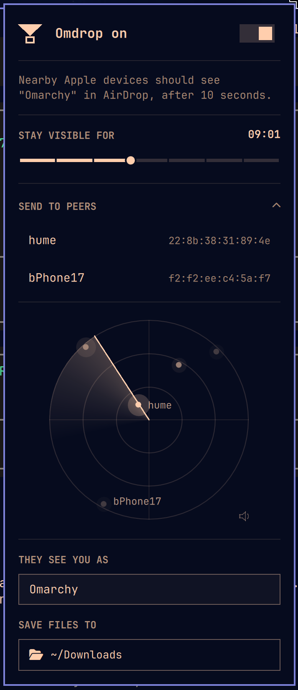

# Omdrop

AirDrop for [Omarchy](https://omarchy.org), on Macs and PCs. Send and receive files with nearby iPhones, iPads, and Macs, in both Everyone and Contacts Only mode.



## Requirements

Omdrop needs a radio backend: the package that gives this computer an `awdl0` interface for AWDL, the Wi-Fi link AirDrop runs on. Install one of these:

- **Apple Silicon Macs with Broadcom Wi-Fi (M1 and M2)**: [omdrop-awdl](https://github.com/netmojo-systems/omdrop-awdl), a `brcmfmac` driver that uses the AWDL built into the Wi-Fi firmware. The plugin installs it on first use. See its [Hardware Compatibility](https://github.com/netmojo-systems/omdrop-awdl/blob/main/README.md#hardware-compatibility).
- **Intel MacBooks with Broadcom BCM4360 Wi-Fi (2013–2017)**: [omdrop-bcm4360](https://github.com/bydash-xyz/omdrop-bcm4360), which runs AWDL in software over Broadcom's `wl` driver. Install it before the plugin. Your Wi-Fi network needs an access point on 5 GHz channel 149, and Wi-Fi moves to it while Omdrop is visible.
- **PCs with other Wi-Fi cards**: [omdrop-owl](https://github.com/t4t5/omdrop-owl), which runs AWDL in software through [OWL](https://github.com/seemoo-lab/owl). Install it before the plugin. Its [Supported hardware](https://github.com/t4t5/omdrop-owl#supported-hardware) table lists the cards that work; on some, Wi-Fi is off while Omdrop is visible.

The two packages conflict, so a computer has one or the other. [docs/radio-backend.md](docs/radio-backend.md) describes what a backend provides.

The bash and Python programs use `tomllib`, built into Python 3.11+, to read TOML configuration; omdrop-core doesn't. On Python 3.10, install `tomli` (`sudo apt install python3-tomli` on Debian/Ubuntu). It must be available to the system `python3` used by the CLI and receiver service, not just a development virtual environment. This supplies the configuration parser; it does not establish full support for other distributions.

[LocalSend](https://localsend.org), which ships with Omarchy, is an open alternative that needs its app on every device.

## Install

```bash
omarchy plugin add https://github.com/netmojo-systems/omdrop-plugin.git
```

Answer yes when it asks to enable the plugin. The icon, a triangle dropping into a box, appears on the right of the bar. To move it, run `omarchy bar move netmojo.omdrop --section center`.

On first use, the panel opens a terminal that asks for your password to:

- Install `python-libarchive-c` and `keyutils` from the official Arch repositories if they are missing. The bash and Python receiver unpacks transfers with the first and reads the cached identity from the kernel keyring with the second; omdrop-core's receiver uses neither. On a Mac, the same step installs the driver: from your package repositories when they carry it, and otherwise built from a pinned commit.
- Add one firewall rule: TCP 8771 on `awdl0`, from IPv6 link-local addresses only.

`omdrop` is always the plugin's command, at `~/.local/bin/omdrop`. `omdrop setup` creates it, and so does the first `omdrop on`, including turning Omdrop on from the panel; to get it before either, run `~/.config/omarchy/plugins/netmojo.omdrop/bin/omdrop setup`. It runs omdrop-core when that is installed and current, and the bash and Python programs otherwise. Run `omdrop --version` to include the version in bug reports.

### From the omdrop package

Once the `omdrop` package is in Omarchy's package repository, it installs the plugin and omdrop-core together, and updates both with the rest of the system:

```bash
omarchy pkg add omdrop      # plain Arch: sudo pacman -S omdrop
/usr/bin/omdrop setup       # once per user: adds the widget to the bar
```

The package puts the plugin in `/usr/share/omdrop`, and `setup` links it into `~/.config/omarchy/plugins`. Run it as `/usr/bin/omdrop` the first time: if you installed Omdrop before with `omarchy plugin add`, a plain `omdrop` may still run that copy, from `~/.local/bin`. `setup` asks before replacing that copy, and moves it aside to a hidden `.netmojo.omdrop.replaced-<date>` directory beside it rather than deleting it. Afterwards `omdrop` runs the package. The radio still comes from its own package: `brcmfmac-awdl-dkms` on an Apple Silicon Mac, `omdrop-bcm4360` on an Intel MacBook, `omdrop-owl` on other Wi-Fi cards.

### omdrop-core

Omdrop runs as omdrop-core, its Rust version, wherever the radio backend supports it, and as its bash and Python programs on other backends. Today omdrop-core supports omdrop-awdl and omdrop-bcm4360; omdrop-owl follows once it ships omdrop-core's hooks ([#73](https://github.com/netmojo-systems/omdrop-plugin/issues/73)).

With a supported backend, `omdrop setup` and `omdrop doctor` offer omdrop-core. Install it with Omdrop off:

```bash
omdrop install-core
```

It first puts the plugin's `omdrop` command at `~/.local/bin/omdrop` if it isn't there, following the same rules as `omdrop setup`, so you keep the command even if the install fails. It then opens a terminal that asks for your password and installs the `omdrop-core` package: from your package repositories when they carry the version this release needs, and otherwise built from the plugin's `core/`. With any other backend, it refuses and installs nothing.

- Once omdrop-core is installed and at least the version this release needs, and the radio backend ships omdrop-core's hooks (omdrop-awdl 0.10.0 and later), the plugin's `omdrop` hands every command to it, including the panel's. omdrop-core's own `omdrop` sits at `/usr/lib/omdrop-core/omdrop`, off your `PATH`, so every command goes through the plugin's.
- With a backend that has no hooks, omdrop-core gets no commands. On a Mac, `omdrop doctor` says to update the driver with `omdrop install-driver`.
- An older omdrop-core gets no commands: the bash and Python programs run instead, and `omdrop doctor` says how to update it.
- Without omdrop-core, the bash and Python programs run, and everything above works the same.
- `OMDROP_IMPLEMENTATION=python` keeps the bash and Python programs with omdrop-core installed; `OMDROP_IMPLEMENTATION=rust` refuses to run without it.

## Upgrade

```bash
omarchy plugin update netmojo.omdrop --yes   # fetch the latest release
omarchy-restart-shell                        # the bar loads the new panel only after a shell restart
omdrop install-core                          # if your radio backend supports omdrop-core, install or update it
omdrop install-driver                        # on a Mac, rebuild the driver if the new release needs a newer one
```

Without `--yes`, `omarchy plugin update` first shows every line that changed, in a pager, before it asks whether to update; for a large release that is thousands of lines. Press `q` to leave the pager and reach the question. To read only which files changed, run `git -C ~/.config/omarchy/plugins/netmojo.omdrop fetch origin` and then `git -C ~/.config/omarchy/plugins/netmojo.omdrop diff --stat HEAD FETCH_HEAD`.

Run `omdrop install-core` first, so that `omdrop install-driver` runs as omdrop-core, which pins the driver and checks it. `omdrop install-driver` and `omdrop install-core` do nothing when everything they install is already current. `omdrop doctor` reports an omdrop-core older than the release needs; only omdrop-core's `omdrop doctor` also reports a driver older than the release needs. On a PC, update the radio backend through its own package: `omdrop install-driver` leaves it alone. If Omdrop is on while you upgrade, turn it off and on again: the receiver keeps running the old version until it restarts. `omdrop install-core` asks you to turn Omdrop off first.

## Receive files

Click the icon to open the panel:

- **The switch** turns receiving on and off. Right-clicking the icon does the same.
- **Stay visible for** sets how long you stay visible: one file, a set time, or until you turn it off.
- **They see you as** sets the name Apple devices show. It defaults to the hostname.
- **Save files to** opens a folder chooser. It defaults to `~/Downloads`.

After a transfer, you can turn receiving off and on again without waiting for the sender's connection to close.

Received files are saved, copied to the clipboard, and announced in a notification. Clicking the notification opens the file.

A shared link arrives as a `.url` or `.webloc` file. Clicking its notification, or double-clicking it in Files, opens it in your browser. Only `http` and `https` links open; a link to anything else, such as `file://` or `smb://`, is refused with a notification, because it was chosen by whoever sent it.

## Send files

Expand **Send to peers**, or press `n` in the panel. If Omdrop is off, this turns it on, because the receive window is what hears nearby devices.

- A radar shows each nearby device as a dot. Brighter and nearer the centre means a stronger signal, not a direction or distance.
- Devices that answer with a name are listed under the heading.
- Click a name or any dot, then choose one or more files. They go as one transfer, so the recipient accepts once. The chooser opens in the folder you last sent from. The row shows progress, and an **×** cancels the send.
- Named devices ping as the sweep passes them. The speaker in the radar's corner mutes the sound, and Omdrop remembers the setting.

While the section is open, Omdrop keeps asking devices for their names. Asking connects to each device and briefly announces your Apple ID over Bluetooth, so that Contacts Only devices answer. Closing the section stops it.

The recipient sees a prompt naming this computer, just as they would for an Apple device. A Mac answers right away. An iPhone listens only in short bursts, so Omdrop keeps trying for 30 seconds and, while it waits, announces this computer over Bluetooth to wake the phone's AirDrop receiver. If the phone still doesn't answer, opening a share sheet on it wakes it. Sending to a Contacts Only device needs an Apple-issued identity on this machine; without one, set the recipient to **Everyone**.

## Command line

The panel's controls are also commands:

```bash
omdrop on 15                      # visible to everyone for 15 minutes
omdrop on -c 10m                  # Contacts Only, for 10 minutes
omdrop on once                    # until one file arrives
omdrop off                        # refuses while a send is running; --force stops anyway
omdrop status
omdrop name "Study Mac"
omdrop dir ~/Drops
omdrop limit 30                   # largest transfer, as % of free disk space
omdrop peers -n                   # nearby devices, with names
omdrop send ~/photo.jpg MyMac     # by name, or --to part of an address
omdrop send ~/a.jpg ~/b.pdf MyMac # several files, accepted once
omdrop send "Studio Mac" https://omarchy.org/
omdrop send --wait 120 ~/photo.jpg iPhone
omdrop send --verbose ~/photo.jpg # protocol log, for bug reports
```

`start`, `stop`, `list`, and `vis` are aliases for `on`, `off`, `peers`, and `visibility`. Run `omdrop help` for the rest.

`omdrop send` accepts `http` and `https` links, including several links in one transfer. A `.webloc` or `.url` file containing a web link is sent as that link so the recipient can open it in a browser, rather than as a downloaded shortcut. Other shortcut files remain files. Send links and files separately. omdrop-core's own sender sends links. Without omdrop-core, the radio backend's sender sends them; if it lacks link support, update the radio backend: `omdrop install-driver` on a Mac, or the backend's own package on a PC.

For a named recipient, `omdrop send` searches for up to two minutes and reports devices as they answer. If Omdrop is off, it turns Omdrop on for the usual 10-minute window first; a send without a name needs Omdrop on already. Names match without regard to case; an exact name takes priority over a substring match. If several devices match, including duplicate exact names, choose one with `--to ADDRESS`. An unfinished lookup sends nothing, even if a matching name has already answered.

`OMDROP_NAME_WAIT` sets the discovery timeout in decimal seconds (1–2147483647, default 120). Leading zeros are allowed; invalid values use the default. omdrop-core waits exactly that long; the bash and Python programs count whole seconds of the clock, so their wait is between one second less and the full value. Stopping lookup processes can take up to two additional seconds, including when a helper stops producing output but remains alive. Cancellation stops the lookup and its probes. `--wait` controls the separate receiver-wake wait after discovery, not the name search.

In `omdrop peers -n` output, `(no response)` means nothing answered on the AirDrop port, and `(anonymous)` means the device answered but withheld its name. To look up names without the Bluetooth announcement, add `--no-wake`; only devices already listening will answer. AWDL addresses change every session.

`omdrop skill install` links a skill that tells AI agents how to use `omdrop`, as `omdrop` in each of `~/.agents/skills`, `~/.claude/skills`, `~/.codex/skills`, and `~/.pi/agent/skills` that exists. Nothing installs it for you: `omdrop setup` only says how, and `omdrop on` never touches it. An existing `omdrop` entry is replaced only when it is a dangling link or a link into a plugin's `skills/omdrop`. `omdrop skill remove` removes those links, and they stay removed.

## Contacts Only

To accept files only from people you choose:

```bash
omdrop senders add you@icloud.com   # an Apple ID email or phone number
omdrop visibility contacts
omdrop visibility everyone          # back to the default
```

The panel shows the same choice as **Everyone** and **Contacts Only** tabs under the timer. You can set it while Omdrop is off, and it is saved, so it applies every time you turn Omdrop on.

The people button at the right of that line opens the known-senders list, with the number of senders beside it. Type an email address or phone number and press Enter to add someone; click a sender to remove them. Changes apply to the next transfer, with no restart.

A sender is accepted only if Apple's signature on their identity record is valid, the record matches the certificate on the connection, and one of its identifiers is on your list. Anyone else is refused before any file data is read. An empty list refuses everyone.

Senders not on your list also don't see you in their share sheet. This hiding is best-effort. Identity isn't bound to the connection at discovery, so someone replaying a known contact's record can see you, but still can't send. A device that sends no verifiable identity is shown, and is refused when it tries to send.

The list is stored in plain text so you can edit it. Identifiers are hashed for comparison and never logged.

Each transfer is capped at 30% of free disk space by default, and at least 1 GiB is always left free. To change the cap, run `omdrop limit PERCENT` with a value from 1 to 90.

## Your AirDrop identity

Apple devices recognize this computer by its AirDrop identity: a certificate, its private key, and, for sending to Contacts Only devices, your Apple ID validation record. Omdrop uses one of three:

| Identity | Where it lives | What it allows |
|---|---|---|
| Self-signed | `~/.omdrop/keys/certificate.self-signed.pem` and `key.self-signed.pem`, created automatically | Receiving from anyone, or only from your known senders; sending to devices set to Everyone. Senders list this computer under Other Devices |
| Apple, on disk | `~/.omdrop/keys/certificate.pem`, `key.pem`, `validation_record.cms` | The same, plus sending to Contacts Only devices whose owner has you as a contact. Your own Apple devices list this computer under My Devices |
| Apple, in 1Password (recommended) | A 1Password item; cached in memory while in use | The same as on disk |

Run `omdrop identity` to see which one is in use.

### Obtaining an Apple-issued identity

Sending to Contacts Only devices requires an Apple-issued **AirDrop identity**, not your Apple Account password. Receiving doesn't: accepting files only from your known senders works with the self-signed identity, because Omdrop checks the sender's Apple-signed record (see [Contacts Only](#contacts-only)). Omdrop does not currently obtain or register an Apple-issued identity for you.

The identity comes from a Mac signed into your own Apple Account: the AirDrop certificate, its matching private key, and the Apple ID validation record. For this project's testing, extracting the certificate and key required booting the Mac into Recovery mode to temporarily disable System Integrity Protection, attaching Frida to `sharingd` back in macOS, and capturing them as they were used during a live AirDrop transfer from that Mac, then turning System Integrity Protection back on from Recovery. This project doesn't document or automate those steps, and they may change between macOS versions.

Anyone holding these keys can present themselves as you over AirDrop, so store them securely: Omdrop can keep them in 1Password instead of on disk, as described below. Use only an identity from a device and account you control, and never share these files in issues, logs, or support requests. **The 1Password import command stores an existing identity; it does not obtain one from Apple.**

Without an Apple-issued identity, Omdrop can still receive from anyone, or only from your known senders, and send to devices whose AirDrop visibility is set to **Everyone**.

### Keep your Apple identity in 1Password

Your Apple identity's private key lets anyone holding it present themselves as you to nearby Apple devices. Keeping it in 1Password takes it off disk. Omdrop fetches it when you turn Omdrop on, keeps it in the kernel's memory for 12 hours, and receives without asking again during that time.

1. Install the [1Password CLI](https://developer.1password.com/docs/cli/get-started/) and open the 1Password app.
2. In 1Password, turn on **Settings → Security → Unlock using system authentication** and **Settings → Developer → Integrate with 1Password CLI**. A polkit authentication agent must be running for 1Password to show its prompt.
3. Move the identity:

   ```bash
   omdrop identity 1password import
   ```

   This creates a 1Password item, **Omdrop AirDrop identity**, reads it back, and deletes the files from `~/.omdrop/keys` only when 1Password holds an identical copy. Add `--vault NAME` to choose a vault. On another computer, `omdrop identity 1password use ITEM` uses the same item.

The first `omdrop on` afterwards asks 1Password for the identity. If 1Password isn't running, is locked, or you dismiss its prompt, that window uses the self-signed identity and a notification says so; until the next window that has your identity, this computer can't send to Contacts Only devices, and senders list it under Other Devices.

When Omdrop asks 1Password for the identity, 1Password asks whether to allow the request and may then ask you to confirm through system authentication, such as your computer's login password or fingerprint, because of the setting in step 2. If you approved a request recently, 1Password may not ask at all. Omdrop asks only when you turn it on without a cached identity, or run `omdrop identity unlock`, `omdrop identity 1password import` or `omdrop identity 1password use`; don't approve a request you didn't start.

| Command | What it does |
|---|---|
| `omdrop identity unlock` | Fetch now, for example when you log in, so the prompt doesn't come mid-task. |
| `omdrop identity lock` | Turn Omdrop off and clear the cached identity. The next `omdrop on` asks again. |
| `omdrop identity 1password off` | Stop using 1Password. The item stays in 1Password. |

To change how long the identity stays cached, set `identity_cache_hours=` (1 to 24) in `~/.config/omdrop/settings`. A window can hold the identity past that, up to 24 hours after it was fetched; after 24 hours Omdrop turns off.

What the cache does and doesn't protect against:

- The cached identity lives in kernel memory, isn't written to a file, and is gone after a reboot or when it expires. Logging out doesn't clear it if your account has systemd lingering enabled.
- Any program running as you, and root, can read it, just as they could read a file only you can open. Linux has no per-app protection like the macOS keychain's.
- While Omdrop is receiving, the receiver holds the key in its own memory. Omdrop keeps it out of core dumps, and `identity lock` stops the receiver before clearing the cache.

## Privileges

The radio helper, `/usr/lib/omdrop/omdrop-discoverable`, runs as root through `pkexec`, because configuring AWDL needs root: vendor commands to the Broadcom firmware, or monitor-mode frame injection with OWL or omdrop-bcm4360. The radio backend package installs the helper and a polkit action that covers only that root-owned path: `org.omarchy.omdrop.discover` from omdrop-awdl, `io.github.bydash-xyz.omdrop-bcm4360.discover` from omdrop-bcm4360, `io.github.t4t5.omdrop-owl.discover` from omdrop-owl. It needs no password from your own active session, and an administrator's password from remote or inactive sessions.

With omdrop-core installed, its root helper, `/usr/lib/omdrop-core/omdrop-radio`, runs as root instead, through polkit action `org.omarchy.omdrop.radio`, with the same password rules. It runs the radio backend's hooks in `/usr/lib/omdrop/radio/`, and the backend's `omdrop-discoverable` when there are none.

The receiver runs as you, so received files are yours. The firewall rule is added with `sudo ufw` in the install terminal, which normally reuses that terminal's earlier authentication.

The AirDrop identity is kept in `~/.omdrop/keys`, or in 1Password; see [Your AirDrop identity](#your-airdrop-identity). If `~/.opendrop/keys` exists and `~/.omdrop` doesn't, Omdrop copies it there once and leaves the original in place for OpenDrop.

Protocol dumps for bug reports are off by default. `omdrop send --verbose` writes them to `$XDG_RUNTIME_DIR/omdrop/debug`, with validation records and certificates replaced by their size.

## Remove

```bash
omdrop firewall remove
omdrop links remove
omdrop skill remove
omdrop identity lock                # clear a cached identity
omarchy plugin remove netmojo.omdrop
sudo pacman -R omdrop-core          # omdrop-core, if installed
sudo pacman -R brcmfmac-awdl-dkms   # the radio backend on an Apple Silicon Mac; omdrop-bcm4360 on an Intel MacBook, omdrop-owl on a PC
rm -rf ~/.omdrop                    # this computer's AirDrop identity
```

## Known limitations

- Folders can't be sent. Compress one first.
- iOS shows a refused Contacts Only transfer as "Waiting..." rather than an error.

## Contributing

To report a bug or request a feature, [open an issue](https://github.com/netmojo-systems/omdrop-plugin/issues). [Pull requests](https://github.com/netmojo-systems/omdrop-plugin/pulls) are welcome; [CONTRIBUTING.md](CONTRIBUTING.md) lists the setup details, hardware evidence, and tests a pull request needs.

`core/` holds [omdrop-core](core/README.md), the Rust version of the `omdrop` command, the receiver, the sender and the root helper. It is what Omdrop runs wherever the radio backend supports it ([omdrop-core](#omdrop-core)), and new development goes into it. The bash and Python programs remain for other backends and for installs without omdrop-core.

## Trademark

"AirDrop" is a trademark of Apple Inc. Omdrop is an independent project, not affiliated with or endorsed by Apple.

## License

MIT. See [LICENSE](LICENSE).
